# Java Console Games

A collection of three console-based games developed individually in Java
as part of university coursework in Object-Oriented Programming.

The project includes Between, Xeri and Shape Game, demonstrating fundamental
Java programming concepts, object-oriented design, data structures,
randomization algorithms, game logic and input validation.

All three games follow the rules of their original academic assignments.

---

## Table of Contents

- [Games](#games)
- [Technologies](#technologies)
- [Object-Oriented Programming](#object-oriented-programming)
- [Data Structures](#data-structures)
- [Algorithms](#algorithms)
- [Input Validation](#input-validation)
- [Manual Testing](#manual-testing)
- [Post-Submission Improvements](#post-submission-improvements)
- [Software Development Skills](#software-development-skills)
- [Project Structure](#project-structure)
- [Getting Started](#getting-started)
- [Academic Information](#academic-information)
- [Individual Contribution](#individual-contribution)
- [Copyright](#copyright)

---

## Games

### 1. Between

Between is a console-based card game in which a player competes against
a dealer by predicting whether a randomly drawn card will fall strictly
between the ranks of two table cards.

The game follows the specific rules of the original academic assignment.

#### Features

- Player versus dealer gameplay.
- Six standard decks containing 312 cards in total.
- Random card shuffling.
- Configurable initial player and dealer balances.
- Betting system with virtual coins.
- Card rank comparison.
- Automatic loss when table cards have equal or consecutive ranks.
- Automatic deck replacement when fewer than half of the cards remain.
- Input validation for betting amounts.
- Automatic winner determination.

#### Game Rules

1. The player specifies the initial amount of coins for both participants.
2. The dealer draws two cards from the card stack.
3. If the cards have equal or consecutive ranks, the player automatically
   loses one coin.
4. Otherwise, the player selects a valid betting amount.
5. A third card is drawn.
6. If its rank is strictly between the two table cards, the player wins
   the bet.
7. Otherwise, the player loses the bet.
8. The game continues until either participant runs out of coins.

#### Main Classes

| Class | Responsibility |
| --- | --- |
| Between | Application entry point and game execution |
| BetweenDealer | Round management and dealer balance |
| BetweenPlayer | Player balance and betting |
| BetweenTable | Table cards and winning conditions |
| Card | Card representation and rank comparison |
| CardStack | Deck creation, shuffling and card drawing |

#### Screenshots

**Input Validation**

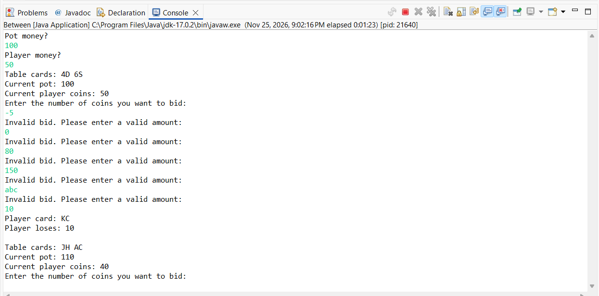

**Winning Round and Game Victory**

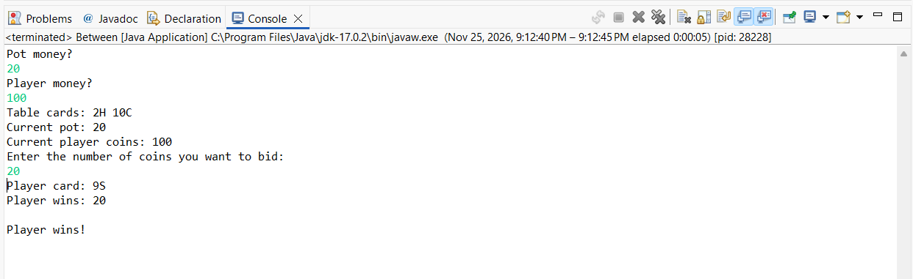

**Automatic Round Loss**

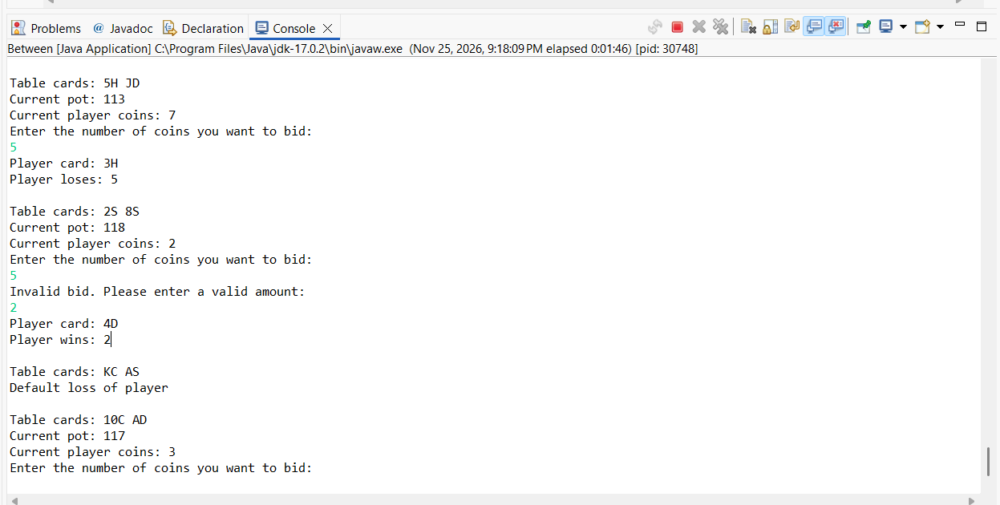

**Game Over**

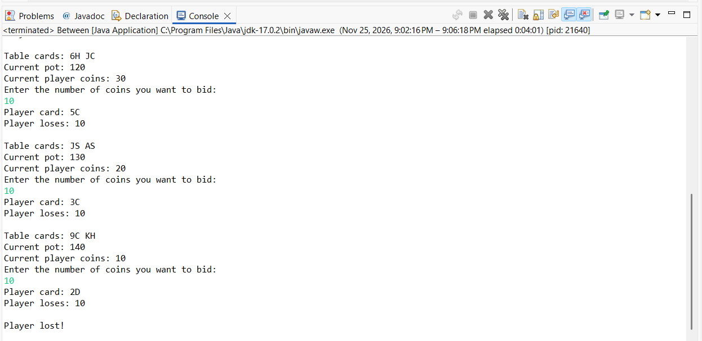

---

### 2. Xeri

Xeri is a console-based implementation inspired by the traditional Greek
card game, following the specific rules and scoring system of the
original academic assignment.

The game allows a human player to compete against a computer-controlled
opponent using a standard deck of 52 cards.

#### Features

- Human versus computer gameplay.
- Standard 52-card deck.
- Four initial cards on the table.
- Six cards dealt to each player per round.
- Four complete dealing rounds.
- Card collection based on matching ranks.
- Special card collection using Jacks.
- Automated computer opponent.
- Xeri and Jack Xeri detection.
- Card-based scoring system.
- Input validation for card selection.
- Automatic winner determination.

#### Computer Opponent

The computer opponent uses a rule-based card selection strategy.

1. Select a card matching the rank of the top table card, if available.
2. Otherwise, select a Jack if the table is not empty and a Jack is available.
3. If neither option is available, select a random card from the hand.

#### Scoring System

| Condition | Points |
| --- | --- |
| Two of Clubs | 2 |
| Ten of Diamonds | 2 |
| Other Tens, Jacks, Queens, Kings and Aces | 1 |
| Most collected cards | 3 |
| Other cards | 0 |

Xeri captures are recorded separately from the final score.

- A regular Xeri increases the Xeri counter by one.
- A Xeri with two Jacks increases the counter by two.

According to the original assignment rules, cards remaining on the table
at the end of the game are not awarded to either player.

#### Main Classes

| Class | Responsibility |
| --- | --- |
| Xeri | Application entry point and game flow |
| XeriPlayer | Player actions, collected cards and scoring |
| Hand | Hand management and computer card selection |
| Pile | Table card management and capture rules |
| CollectedCards | Captured cards and Xeri detection |
| Card | Card representation and special card identification |
| CardStack | Deck creation, shuffling and card drawing |

#### Screenshots

**Input Validation and Card Collection**

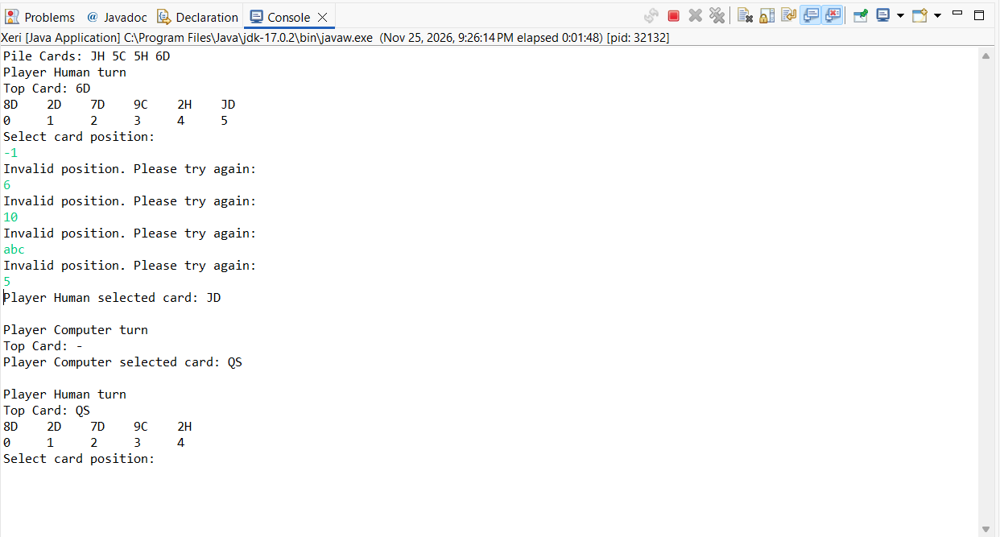

**Gameplay and Xeri Detection**

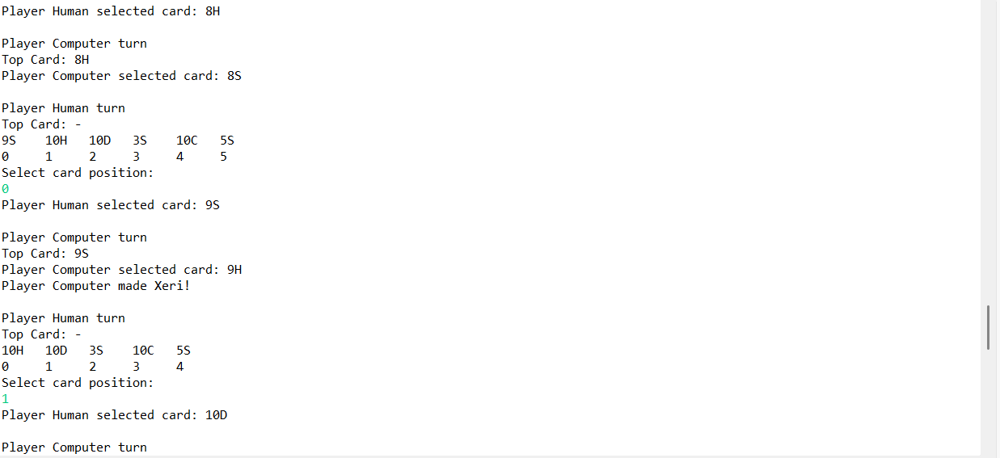

**Final Results**

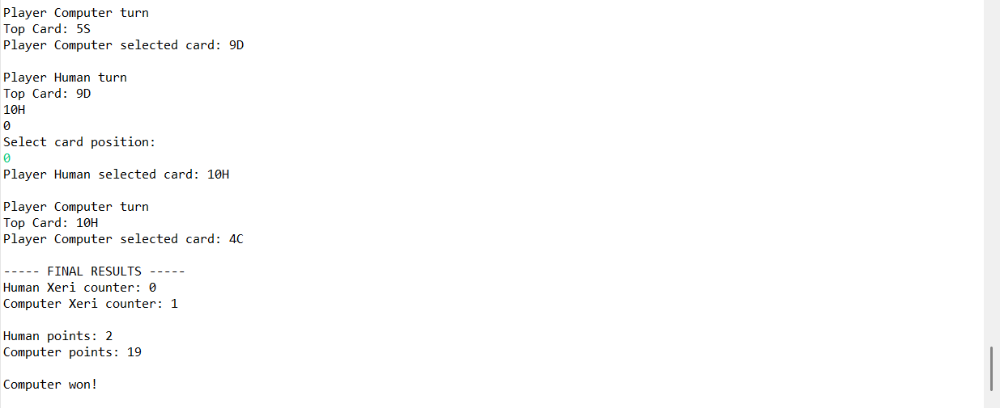

---

### 3. Shape Game

Shape Game is an educational console-based game involving geometric
shapes, stack management and score calculation.

The game focuses on object-oriented programming concepts such as
abstraction, inheritance, polymorphism and method overriding.

The player receives randomly generated shapes and decides whether to
accept or reject them.

Accepted shapes affect the player's score and stack according to their
relationship with the shape currently at the top of the stack.

#### Features

- Five different shape classes.
- Random shape generation.
- Configurable number of shapes.
- Configurable stack capacity.
- Shape acceptance and rejection.
- Area-based score calculation.
- Shape type and area comparison.
- Special matching rules.
- Score multiplication.
- Bonus circle functionality.
- Input validation.
- Automatic game termination.
- Final stack and score presentation.

#### Supported Shapes

| Shape | Area Calculation |
| --- | --- |
| Square | Bounding rectangle area |
| Triangle | 0.5 × Bounding rectangle area |
| Pentagon | 0.75 × Bounding rectangle area |
| Circle | (3.14 / 4) × Bounding rectangle area |
| BonusCircle | Circle area with additional bonus points |

The area formulas follow the original educational assignment.

Bonus circles provide additional points ranging from 1 to 10.

#### Game Rules

| Condition | Stack Operation | Score Multiplier |
| --- | --- | --- |
| Empty stack | Add incoming shape | ×1 |
| Same type and area | Remove top shape without adding incoming shape | ×10 |
| Same area only | Add incoming shape | ×10 |
| Same type only | Remove top shape without adding incoming shape | ×1 |
| Different type and area | Add incoming shape | ×1 |
| Rejected shape | No change | ×0 |

The game ends when:

- The player's stack reaches its maximum capacity, or
- All generated shapes have been processed.

#### Main Classes

| Class | Responsibility |
| --- | --- |
| ShapeGame | Application entry point and game execution |
| Shape | Abstract base class for geometric shapes |
| Square | Square area calculation |
| Triangle | Triangle area calculation |
| Pentagon | Pentagon area calculation |
| Circle | Circle area calculation |
| BonusCircle | Circle specialization with bonus points |
| Player | Stack management and score calculation |
| ShapeGenerator | Random shape generation and management |
| ShapeGeneratorMain | Standalone shape generator demonstration |

#### Screenshots

**Input Validation**

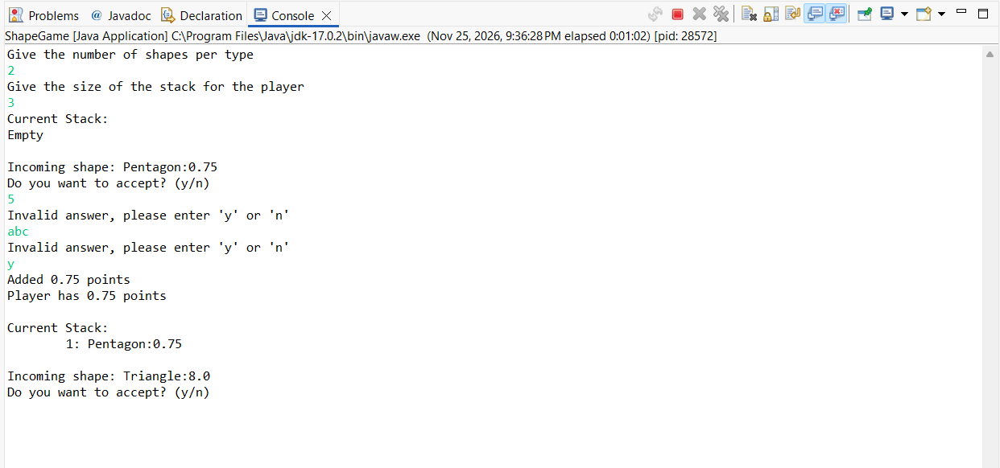

**Matching Shapes and Score Multiplication**

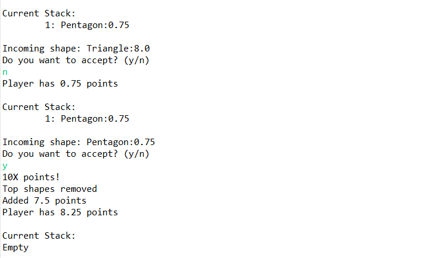

**Bonus Circle**

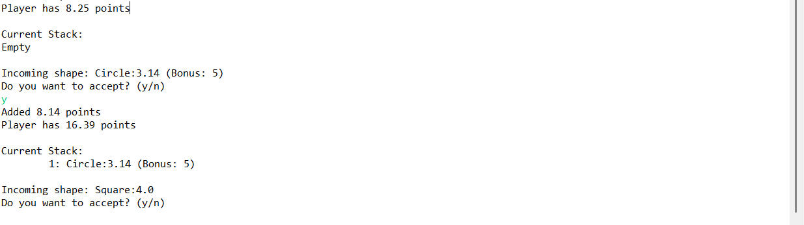

**Game Over — Full Stack**

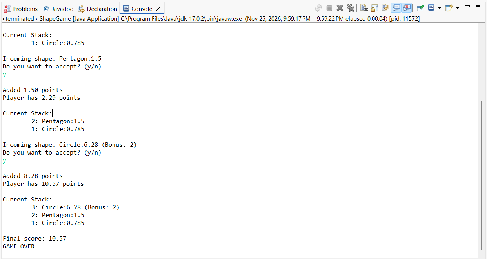

**Game Over — Exhausted Shapes**

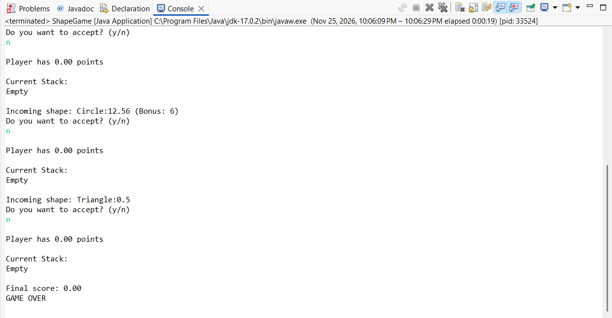

---

## Technologies

| Technology | Purpose |
| --- | --- |
| Java | Core programming language |
| Java SE Standard Library | Collections, randomization and console I/O |
| JDK 17 | Development and execution environment |
| Eclipse IDE | Development and manual testing |
| Git | Version control |
| GitHub | Source code hosting and portfolio presentation |

The games do not require external libraries or frameworks.

---

## Object-Oriented Programming

The project demonstrates fundamental object-oriented programming
principles through the implementation of the three games.

### Encapsulation

Private fields and public methods are used to manage internal object
state and separate responsibilities.

Examples include:

- Card rank and suit.
- Player balances.
- Player hands.
- Collected cards.
- Shape properties.
- Stack contents.
- Game scores.

### Abstraction

The abstract Shape class defines common properties and behavior for
geometric shapes.

Each concrete subclass provides its own implementation of the
`computeArea()` method.

### Inheritance

Shape Game uses the following inheritance hierarchy:

    Shape (abstract)
    |
    |-- Square
    |-- Triangle
    |-- Pentagon
    |-- Circle
        |
        |-- BonusCircle

The BonusCircle class extends Circle and introduces additional
scoring behavior.

### Polymorphism

Different shape objects are managed through references of type Shape.

The appropriate area and point calculation methods are selected
dynamically according to the actual object type.

### Method Overriding

Concrete shape classes override `computeArea()` to implement their
individual area calculations.

BonusCircle overrides `computePoints()` to provide additional points.

Several classes also override `toString()` to provide meaningful
console output.

### Composition

The games use object composition to organize their responsibilities.

Examples include:

- BetweenDealer contains a CardStack.
- BetweenTable manages Card objects.
- XeriPlayer contains a Hand and a collection of captured cards.
- Hand and Pile manage collections of Card objects.
- Player manages a stack of Shape objects.
- ShapeGenerator manages generated Shape objects.

---

## Data Structures

The project uses several fundamental data structures.

| Data Structure | Usage |
| --- | --- |
| Arrays | Card decks, table cards and generated shapes |
| ArrayList | Player hands, captured cards and temporary collections |
| Stack | Shape Game player inventory |

The Shape Game stack is implemented using a fixed-size array and
a counter that tracks the number of stored shapes.

---

## Algorithms

### Fisher-Yates Shuffle

The Fisher-Yates algorithm is used to shuffle card decks and
generated shapes efficiently.

Time complexity: O(n).

### Constant-Time Element Retrieval

Cards and shapes are retrieved from the end of their underlying
arrays using a counter.

Time complexity: O(1) per retrieval.

This approach avoids reallocating and copying the entire array
whenever an element is removed.

### Sequential Search

Sequential search is used by the Xeri computer opponent to find:

- Cards matching the rank of the top table card.
- Available Jacks.

Time complexity: O(n).

### Score Calculation

Collected cards and accepted shapes are evaluated according to
the rules of each game.

---

## Input Validation

The games include input validation to prevent invalid user actions.

### Between

- Positive initial balances.
- Positive betting amounts.
- Bets within both available balances.
- Rejection of non-numeric input.

### Xeri

- Valid card positions.
- Rejection of negative positions.
- Rejection of out-of-bounds positions.
- Rejection of non-numeric input.

### Shape Game

- Positive number of shapes.
- Positive stack capacity.
- Validation of acceptance and rejection responses.

---

## Manual Testing

The games were manually executed in Eclipse using JDK 17.

Representative gameplay scenarios were examined to verify the
main functionality of each application.

| Game | Manually Verified Scenarios |
| --- | --- |
| Between | Input validation, winning and losing rounds, automatic round loss, balance updates and game termination |
| Xeri | Card dealing, input validation, card collection, computer moves, Xeri detection, complete gameplay and final scoring |
| Shape Game | Input validation, shape acceptance and rejection, matching shapes, score multiplication, bonus points and both termination conditions |

Screenshots of representative execution scenarios are included
in the documentation directory.

Testing was performed manually rather than through an automated
unit testing framework.

The manual checks cover representative scenarios and do not
constitute exhaustive testing of every possible game state.

---

## Post-Submission Improvements

Following the original academic submissions, the games were reviewed
and refined with AI-assisted development support.

The improvements focused on correcting implementation issues,
improving readability and presenting the projects more clearly,
while preserving the original academic game rules.

### Between Improvements

- Corrected betting amount validation.
- Corrected handling of equal-ranked table cards.
- Improved console input handling.
- Improved deck shuffling.
- Reduced unnecessary array copying.
- Improved code readability.

### Xeri Improvements

- Corrected the game loop to include the final dealing round.
- Corrected computer access to the current top table card.
- Corrected computer card selection.
- Improved card position validation.
- Corrected Jack Xeri detection.
- Prevented repeated score calculation from duplicating points.
- Simplified card collection logic.

### Shape Game Improvements

- Corrected the game termination conditions.
- Corrected stack capacity management.
- Improved shape generation and retrieval.
- Improved console input validation.
- Added final stack and score presentation.
- Improved numeric formatting and console readability.

### General Improvements

- English variable names and comments.
- Consistent code formatting.
- Removal of unnecessary code.
- Removal of student identification information.
- Organized project structure.
- Manual verification of representative gameplay scenarios.
- Project documentation and screenshots.

---

## Software Development Skills

This collection demonstrates experience with:

- Java Programming
- Object-Oriented Programming
- Encapsulation
- Abstraction
- Inheritance
- Polymorphism
- Method Overriding
- Object Composition
- Arrays and Collections
- Stack Implementation
- Algorithm Implementation
- Randomization
- Input Validation
- Game Logic
- Rule-Based Computer Opponents
- Debugging
- Code Refactoring
- Manual Testing
- Technical Documentation
- Git and GitHub

---

## Project Structure

    java-console-games/
    |
    |-- between/
    |   |-- src/
    |       |-- Between.java
    |       |-- BetweenDealer.java
    |       |-- BetweenPlayer.java
    |       |-- BetweenTable.java
    |       |-- Card.java
    |       |-- CardStack.java
    |
    |-- xeri/
    |   |-- src/
    |       |-- Xeri.java
    |       |-- XeriPlayer.java
    |       |-- Hand.java
    |       |-- Pile.java
    |       |-- CollectedCards.java
    |       |-- Card.java
    |       |-- CardStack.java
    |
    |-- shape-game/
    |   |-- src/
    |       |-- ShapeGame.java
    |       |-- Shape.java
    |       |-- Square.java
    |       |-- Triangle.java
    |       |-- Pentagon.java
    |       |-- Circle.java
    |       |-- BonusCircle.java
    |       |-- Player.java
    |       |-- ShapeGenerator.java
    |       |-- ShapeGeneratorMain.java
    |
    |-- docs/
    |   |-- screenshots/
    |
    |-- README.md
    |-- .gitignore

Each game is maintained in a separate directory to preserve its
independent implementation and avoid conflicts between classes
with identical names.

---

## Getting Started

### Prerequisites

- Java Development Kit (JDK 17 recommended).
- A terminal or Java-compatible IDE.
- Git (optional, for cloning the repository).

### Clone the Repository

Clone or download the repository from GitHub.

Navigate to the `java-console-games` directory.

### Run Between

```bash
mkdir between/out
javac -d between/out -sourcepath between/src between/src/Between.java
java -cp between/out Between
```

### Run Xeri

```bash
mkdir xeri/out
javac -d xeri/out -sourcepath xeri/src xeri/src/Xeri.java
java -cp xeri/out Xeri
```

### Run Shape Game

```bash
mkdir shape-game/out
javac -d shape-game/out -sourcepath shape-game/src shape-game/src/ShapeGame.java
java -cp shape-game/out ShapeGame
```

### Run the Shape Generator Demonstration

```bash
javac -d shape-game/out -sourcepath shape-game/src shape-game/src/ShapeGeneratorMain.java
java -cp shape-game/out ShapeGeneratorMain
```

Create the `shape-game/out` directory first if it does not already exist.

The commands above are intended to be executed from the root
directory of the repository.

### Running in Eclipse

1. Open Eclipse IDE.
2. Create three separate Java Projects.
3. Copy the corresponding Java source files into each project's
   src directory.
4. Configure the project to use JDK 17.
5. Open the appropriate main class.
6. Select Run As > Java Application.

| Game | Main Class |
| --- | --- |
| Between | Between.java |
| Xeri | Xeri.java |
| Shape Game | ShapeGame.java |
| Shape Generator Demonstration | ShapeGeneratorMain.java |

Between and Xeri must be compiled as separate projects because
they contain classes with identical names.

---

## Academic Information

- University: University of Ioannina
- Department: Computer Science and Engineering
- Subject: Java / Object-Oriented Programming
- Project Type: Individual Academic Programming Assignments
- Development Team: Individual Developer
- Programming Language: Java
- Number of Games: 3
- Number of Java Source Files: 23

The original implementations were developed individually as university
coursework and subsequently refined for portfolio presentation.

---

## Individual Contribution

All three games were originally developed individually, with the
implementation, debugging and development work completed independently
according to the academic assignment requirements.

---

## Copyright

This repository contains individual academic work presented for
educational and professional portfolio purposes.

The original assignment specifications and game requirements are
attributed to their respective academic authors.

No open-source license is granted by this repository.

All applicable rights remain with their respective owners.
